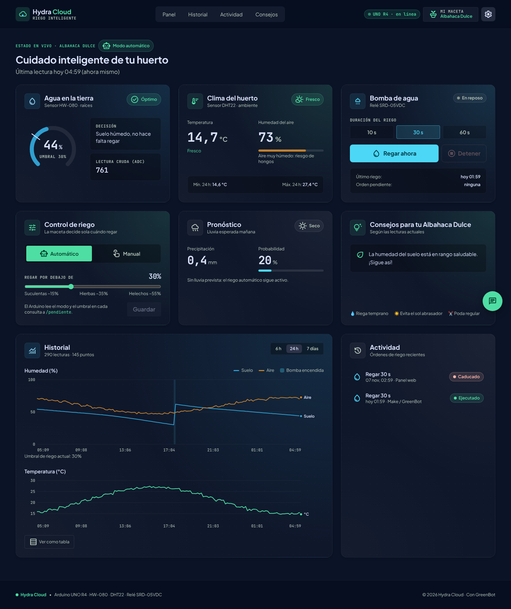

# Hydra Cloud 🌱💧

Maceta inteligente con **Arduino UNO R4**, monitoreo web y el asistente **GreenBot**.



## Hardware

| Pieza | Función |
|---|---|
| Arduino UNO R4 WiFi | Lee sensores, controla la bomba y habla con la API |
| HW-080 | Humedad del suelo (resistivo, salida analógica) |
| DHT22 | Temperatura y humedad del aire |
| Relé SRD-05VDC | Enciende/apaga la bomba |
| Bomba de agua | Riego |

## Arquitectura

```
Arduino ──► Make (clima + decisión) ──POST /api/humedad──► API Express ──► MongoDB
   ▲                                                          │
   └──── GET /api/comandos/pendiente (cada N s) ◄─────────────┘
Panel React ◄── GET /api/humedad, /historial, /comandos ── API (vía ngrok)
GreenBot (panel) ──► Webhook de Make ──► Groq ──► { reply }
```

## Puesta en marcha

```bash
cd server && cp .env.example .env   # rellena MONGO_URI y API_TOKEN
npm install && npm start
```

```bash
cd client && cp .env.example .env   # VITE_GREENBOT_WEBHOOK, VITE_API_URL opcional
npm install && npm run dev
```

Sin Arduino ni MongoDB puedes probar el panel con datos simulados:

```bash
cd client && npm run mock     # API falsa en :5000, token "demo"
```

Túnel con ngrok (usa tu **dominio estático gratuito** para que la URL no cambie):

```bash
ngrok http --url=TU-DOMINIO.ngrok-free.app 5000
```

## Arduino

1. Instala el core **Arduino UNO R4 Boards** y las librerías *ArduinoJson*, *Adafruit SSD1306*, *Adafruit GFX* y *DHT sensor library*.
2. Copia `arduino/hydra_cloud/arduino_secrets.example.h` como `arduino_secrets.h` y rellena WiFi, Make y tu dominio de ngrok.
3. Abre `arduino/hydra_cloud/hydra_cloud.ino` y súbelo.

Varias macetas: cambia `DEVICE_ID` en cada placa y abre el panel con `?device=maceta2`.

## API

| Método | Ruta | Auth | Uso |
|---|---|---|---|
| POST | `/api/humedad` | `API_TOKEN` | Make guarda una lectura |
| GET | `/api/humedad/:device` | — | Última lectura |
| GET | `/api/humedad/:device/historial?horas=24` | — | Serie reducida (≤240 puntos, máx 168 h) |
| POST | `/api/comandos` | `API_TOKEN` | `{device_id, accion:"regar"|"detener", duracion:1-120}` |
| GET | `/api/comandos/pendiente` | `DEVICE_TOKEN`* | Arduino: `{hayComando, accion, id, duracion, modo, umbral}` |
| PUT | `/api/comandos/completar/:id` | `DEVICE_TOKEN`* | Arduino confirma |
| GET | `/api/comandos/recientes?device_id=` | — | Registro de actividad |
| GET/PUT | `/api/dispositivos/:device` | PUT: `API_TOKEN` | Modo auto/manual, umbral, nombre de planta |
| GET | `/api/health` | — | Estado del servidor y MongoDB |

\* Solo si defines `DEVICE_TOKEN`; si está vacío esas rutas siguen abiertas para no romper el sketch actual.

## GreenBot

El panel envía al webhook de Make:

```json
{ "device_id": "maceta1",
  "transcript": "Usuario: ¿Cómo está mi planta?",
  "messages": [{ "role": "user", "content": "¿Cómo está mi planta?" }],
  "context": { "planta": "Albahaca Dulce", "humedad_suelo": 44, "temperatura": 22.1,
               "humedad_aire": 58, "bomba_encendida": false, "modo": "auto", "umbral_riego": 30,
               "lluvia_mm": 0.4, "prob_lluvia": 20, "arduino_en_linea": true, "ultima_lectura": "…" } }
```

y espera `200 { "reply": "…" }`.

Para incrustar GreenBot en otra web está `client/public/greenbot-widget.js` (prueba: `client/public/greenbot-demo.html`).
Envía `{ device_id, messages, transcript }` sin `context`, así que en Make conviene leer las lecturas con `GET /api/humedad/{{device_id}}`:

```html
<script src="greenbot-widget.js" data-webhook="https://hook.us2.make.com/TU_ID" data-device="maceta1" data-history="1" defer></script>
``` Ver [docs/REVISION.md](docs/REVISION.md) para cómo usar `context` en Make.
